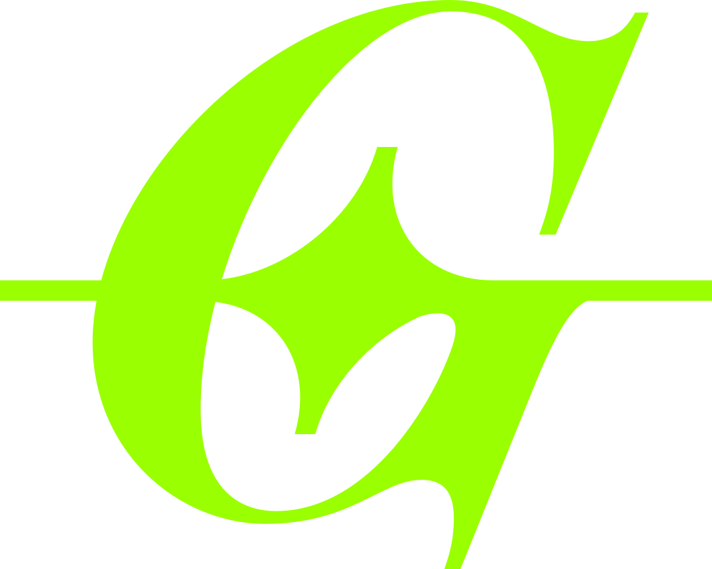

<div align="center">
  

  # GlyphClub

  **A real cross-platform font manager.** Not a fancy web app wrapper.

  [](https://github.com/tonykastaneda/GlyphClub/actions/workflows/build.yml)
</div>

GlyphClub activates and deactivates fonts from whatever folder your team
already syncs — Dropbox, Google Drive, iCloud, OneDrive, SMB, anything.
There's no OAuth, no cloud account, and no web app pretending to be a
desktop app: it's a native macOS/Windows application that just watches and
reads plain folders, with a native GPUI interface.

## Features

- **Grid and list views** of your whole library, virtualized to stay smooth
  scrolling through very large libraries (100k+ fonts).
- **Live previews**, including System Fonts, with a dimmed fallback for any
  tile whose font genuinely lacks glyphs for the current sample text.
- **Starred and Recent** filters alongside your own library folders, each
  individually hideable from the sidebar via Settings.
- **One-click activation/deactivation**, plus a temporary-activation mode,
  reconciled against every library folder you have open.
- **A detail panel** for the selected font — a real live-type Preview
  editor (click-drag selection, word/line/paragraph keyboard navigation,
  alignment, point size), a Sizes specimen ladder, a searchable Glyphs
  grid with Unicode block filtering, and an Info tab with extracted
  metadata. Resizable by dragging its edge.
- **Light and Dark themes**, following System Default or set explicitly.
- **A real native menu bar on macOS** (via `muda`), and a matching
  hand-rolled one on Windows.

## Illustrator plug-in (macOS)

`plugin/` is a native Illustrator 2026 plug-in that auto-activates a
document's missing fonts. When a document opens, it asks Illustrator which
fonts are stand-ins for missing ones and sends their PostScript names to
GlyphClub over a loopback connection (`src/illustrator_bridge.rs`: a random
port and a per-launch token in `~/Library/Application Support/glyphclub/bridge.json`,
readable only by you). GlyphClub temporarily activates whatever its libraries
have, starting in the background first if it isn't running. Illustrator then
picks the fonts up itself, even while its Missing Fonts dialog is open.
**Window ▸ Glyph Club** shows the connection, an auto-activate switch and
recent activity.

Install it from **Settings ▸ Integrations**, which copies it into each
Illustrator 2026 in `/Applications` (using the macOS administrator prompt,
since the Plug-ins folder is owned by root). To build it yourself you need
only the Command Line Tools and Adobe's Illustrator SDK at
`~/Developer/AdobeIllustratorSDK` (or `SDK=...`); no Xcode:

```sh
make -C plugin          # plugin/build/GlyphClub.aip, arm64, signed ad hoc
```

A `cargo run` build offers that copy in Integrations.

The plug-in has its own version in `plugin/VERSION`, separate from the
app's. Bump it whenever the plug-in changes, and only then. When an installed
(or connected) plug-in is older than the one GlyphClub ships, GlyphClub shows
an update banner that opens Integrations, and the plug-in's panel says the
same with an **Open Glyph Club** button. Release builds bundle
it into GlyphClub.app when the SDK is available (see `scripts/package-macos.sh`
and the optional `ILLUSTRATOR_SDK_TOKEN` secret in the release workflow).

## Building and running

```sh
cargo run --release
```

Requires a recent stable Rust toolchain. Builds natively on macOS and
Windows. `GlyphClub` is the main GPUI application; `glyphclub-cli` manages
fonts and controls the running app. Packaged releases include the branding
icon and all bundled icon sets with their licenses.

## Releasing

Pushing a tag like `v0.1.0` runs `.github/workflows/release.yml`, which
builds, signs, and notarizes a macOS DMG (Apple Silicon only) and builds a
Windows zip (unsigned — no code-signing cert yet, so SmartScreen will warn
on first run until one's added), then opens a draft GitHub Release with
both attached. `scripts/package-macos.sh`/`scripts/package-windows.ps1` are
the actual build/package logic; the workflow is mostly just credentials
plumbing around them, and `package-macos.sh` also works standalone for a
local build (it'll use a `notarytool` keychain profile instead of the CI
API-key path — see below).

**One-time setup**, before the workflow can actually sign/notarize —
add these six as this repo's Settings → Secrets and variables → Actions →
Repository secrets:

| Secret | Where it comes from |
| --- | --- |
| `APPLE_SIGN_IDENTITY` | The exact string from `security find-identity -v -p codesigning`, e.g. `Developer ID Application: Your Name (TEAMID)`. |
| `MACOS_CERTIFICATE_P12_BASE64` | Export that identity (cert + private key) from Keychain Access as a `.p12`, then `base64 -i cert.p12 \| pbcopy`. |
| `MACOS_CERTIFICATE_PASSWORD` | Whatever password you set when exporting the `.p12` above. |
| `APPLE_API_KEY_BASE64` | An App Store Connect API key's `.p8` file (Users and Access → Integrations → App Store Connect API), `base64 -i AuthKey_XXXX.p8 \| pbcopy`. |
| `APPLE_API_KEY_ID` | The Key ID shown next to that API key. |
| `APPLE_API_ISSUER_ID` | The Issuer ID shown at the top of the same Integrations page. |

For a local (non-CI) run of `./scripts/package-macos.sh` instead, skip the
API key entirely and just run
`xcrun notarytool store-credentials glyphclub-notary` once — it'll prompt
for the same Apple ID/API key info and stash it in your keychain under
that profile name, which the script uses by default.

## Project layout

- `src/next/` — the main GPUI application, views, settings and Illustrator bridge.
- `src/lib.rs` and the shared modules in `src/` — catalog, scanning,
  activation and font metadata. `src/cli/` contains the command-line tool.
- `vendor/` — the GPUI patch supporting direct vector artwork dragging.
- `plugin/` — the Illustrator plug-in (C++/Objective-C++, built with `make`).
- `branding/` — the source SVGs/icon assets this README and the app's own
  UI (format badges, dock icon, wordmark) are drawn from.
- `docs/` — the project's marketing site.
